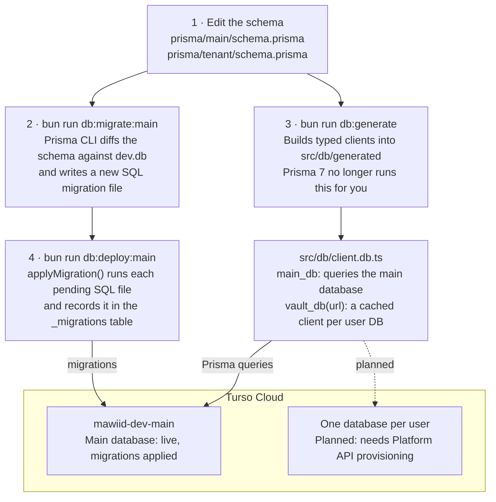

# Mawiid Backend Setup Summary

_Last updated: 2026-10-19_

The backend (Bun + Elysia) now reads and writes a Turso cloud database through Prisma 7. Schema changes are made locally and pushed to Turso with one command; per-user databases are designed but not wired up yet.

## How it fits together

Prisma's CLI only ever touches local files. Turso is changed only by `db:deploy:main` and read and written at runtime through `client.db.ts`.

## Stack

The database layer is Prisma 7 on top of Turso (hosted libSQL, a SQLite fork), run with Bun on Windows.

| Tool                     | Version                    | Role                                           |
| ------------------------ | -------------------------- | ---------------------------------------------- |
| Bun (Windows)            | 1.4.2                      | Runtime, package manager, script runner        |
| Elysia                   | 1.4.30                     | HTTP framework; no routes registered yet       |
| TypeScript               | 5.9.3                      | Pinned compiler for repeatable typechecking    |
| `prisma` (CLI)           | 7.10.1                     | Creates migrations, generates the typed client |
| `@prisma/client`         | 7.10.1                     | Typed queries in our code                      |
| `@prisma/adapter-libsql` | 7.10.1                     | Connects Prisma to Turso; required in Prisma 7 |
| `@libsql/client`         | 0.18.0                     | Raw Turso client, used by our migration runner |
| Turso Cloud              | database `mawiid-dev-main` | Hosted database                                |

Keep the three Prisma packages on the same version. npm's `latest` tag for `prisma` points at an 8.0 release candidate, so `package.json` pins them to 7.

## Databases

Data is split into one shared main database and one separate database per user (the tenant database). Only the main database exists so far.

|                | Main database                                                        | Tenant database                                                            |
| -------------- | -------------------------------------------------------------------- | -------------------------------------------------------------------------- |
| How many       | One: `mawiid-dev-main` on Turso                                      | One per user; none created yet                                             |
| Holds          | Users, plus the URL of each user's own database (`User.databaseUrl`) | That user's private data; the schema is a placeholder `User` model for now |
| Schema file    | `prisma/main/schema.prisma`                                          | `prisma/tenant/schema.prisma`                                              |
| Client in code | `main_db`                                                            | `vault_db(url)`, one cached client per database                            |
| Feature code   | `src/module/main/*`: auth, user, organization, department, health    | `src/module/tenant/*`: room, message, translation, access, audit           |
| Status         | Live; both migrations applied and tested                             | Group-token connections implemented; automatic provisioning still pending  |

Why separate databases: one user's data cannot leak into another's through a forgotten `WHERE` clause, and a user's data can be exported or deleted as a single database. `vault_db` keeps at most `DB_MAX_CACHED_TENANTS` (default 100) connections open and closes the least recently used.

## Files

All paths are in `apps/backend` unless noted. The app bootstrap, required-variable check, and TCP Redis client are implemented. Feature modules and the other library/storage files remain placeholders.

| Path                                               | What it does                                                                                                             | In git |
| -------------------------------------------------- | ------------------------------------------------------------------------------------------------------------------------ | ------ |
| `prisma/main/schema.prisma`                        | Main database tables                                                                                                     | Yes    |
| `prisma/tenant/schema.prisma`                      | Tables every user database gets                                                                                          | Yes    |
| `prisma/*/migrations/`                             | Generated SQL migrations, one folder per change                                                                          | Yes    |
| `prisma/*/dev.db`                                  | Local scratch SQLite files the Prisma CLI compares against                                                               | No     |
| `prisma.main.config.ts`, `prisma.tenant.config.ts` | Prisma 7 config: schema path, migrations path, scratch database                                                          | Yes    |
| `src/db/generated/`                                | Generated Prisma clients, rebuilt by `db:generate`                                                                       | No     |
| `src/db/client.db.ts`                              | `create_database_client()` creates `main_db`, cached `vault_db(url)` clients, and a shutdown helper                      | Yes    |
| `src/lib/env.lib.ts`                               | Checks the required variable list and exits with missing variable names                                                  | Yes    |
| `src/storage/redis.storage.ts`                     | Creates Bun's native TCP Redis client, with TLS for `rediss://` URLs                                                     | Yes    |
| `src/app.ts`                                       | Checks required variables, starts Elysia, exposes clients to future handlers, and handles shutdown; no routes registered | Yes    |
| `src/db/utils.db.ts`                               | `applyMigration(url, dir, token)`: applies pending migrations to any Turso database, tracked in a `_migrations` table    | Yes    |
| `src/db/migrate.db.ts`                             | Runs `applyMigration` on the main Turso database                                                                         | Yes    |
| `.env` (repo root)                                 | Turso main/group settings and the TCP `REDIS_URL`                                                                        | No     |
| `.env.example` (repo root)                         | Required settings, placeholders, and optional defaults                                                                   | Yes    |

## Startup configuration

The running backend requires `TURSODB_URL`, `TURSODB_TOKEN`, `TURSODB_DB`, `TURSODB_ORG`, `TURSODB_GROUP_NAME`, `TURSODB_GROUP_TOKEN`, and `REDIS_URL`. The main database uses `TURSODB_TOKEN`; per-user database connections use `TURSODB_GROUP_TOKEN`. The group token is a SQL credential, not a Platform API token for creating databases.

For Upstash TCP, use the `rediss://` connection string from the console, including its password and port. The HTTP REST URL/token pair is not used. Plain `redis://` URLs are also accepted for local Redis; Upstash requires TLS.

To require another variable, add its name to the `required` array in `src/lib/env.lib.ts`. Clients read `process.env` directly. Optional defaults are `APP_NAME=mawiid`, `BACKEND_PORT=3000`, and `DB_MAX_CACHED_TENANTS=100`. There is no URL, numeric, or environment-name validation.

Run `bun run dev:backend` from the repository root to start the server. No HTTP endpoints, including health endpoints, are implemented. Clients connect lazily when used. On SIGINT/SIGTERM, the server stops and closes Redis and cached database clients. Missing-variable errors list names without printing secret values.

## Daily workflow

A schema change takes three commands and a commit, run from `apps/backend` in a Windows terminal.

First time only: run `bun install` at the repo root, copy `.env.example` to `.env` and ask for the Turso values, then run `bun run db:generate`.

1. Edit `prisma/main/schema.prisma` (or the tenant schema).
2. `bun run db:migrate:main --name add_rooms` creates a new SQL migration and applies it to the local scratch file. Use `db:migrate:tenant` for the tenant schema. Name it in snake_case after the change.
3. `bun run db:generate` refreshes the typed clients. Prisma 7 no longer does this automatically after a migration.
4. `bun run db:deploy:main` applies pending migrations to Turso. It is safe to rerun: applied migrations are skipped.
5. Commit the schema change and its new `migrations/` folder.

## Rules and gotchas

Read these before your first command; most of them have already broken the setup once.

- **Install packages with Bun on Windows only.** `npm install` run from WSL replaced Bun's links with Linux symlinks Windows cannot follow, and every Prisma command failed. The fix was deleting `node_modules` and running `bun install` again.
- **Call command-line tools as `bun x <tool>` in scripts.** Windows Device Guard blocks the unsigned `.exe` launchers Bun creates in `node_modules\.bin`. Bun only reports "unknown error".
- **Prisma's CLI cannot migrate Turso.** `migrate dev` and `migrate deploy` accept only local SQLite files; a `libsql://` or `http://` URL fails with error P1013. That is why migrations are generated against `dev.db` and applied to Turso by `applyMigration`.
- **Prisma 7 differs from most tutorials.** The database URL lives in `prisma.*.config.ts`, not in the schema. The generator is `prisma-client` with an `output` path. Clients need the `PrismaLibSql` adapter; older Turso docs show `PrismaLibSQL` and a `driverAdapters` flag, both outdated.
- **Turso tokens stay on the backend.** Never commit `.env`, and never send a token to the desktop, mobile or portal apps.
- **TypeScript is pinned to 5.9.3.** `bun run typecheck` uses the installed compiler instead of downloading an incompatible newer version. Bun's runtime/test types are also installed.

## Open questions

- [ ] Does "user" mean a person or a customer organization? Shared rooms and messages need a database every participant can reach. Code comments and folder names still say "department vault".
- [ ] Automatic user database creation still needs a Platform API token restricted to the Mawiid group. The SQL group token is already wired into tenant connections; it cannot create databases.
- [ ] `User.databaseUrl` is required, so signup must create the user's database before inserting the user row. Keep that order, or make the field optional.
- [ ] The tenant schema is still a copy of the main `User` model; it needs its real tables.
- [ ] The README plans offline and air-gapped installs (`infra/offline`, Compose). A cloud-only database rules those out unless we switch the URL to a self-hosted libSQL server for them; no code change is needed for that.
