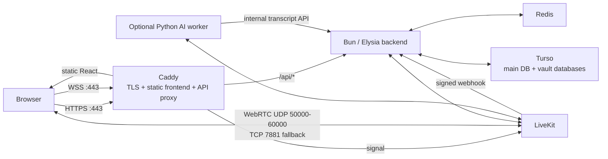

# Mawiid production deployment runbook

This is the deployment runbook for an engineer or coding agent who has not worked on Mawiid before. It describes the current repository, the single-VPS production topology, exact deployment sequence, verification, updates, rollback limits, and failure diagnosis.

It targets the Debian amd64 VPS that serves:

- App: `mawiid.laedxdigitalstudio.com`
- LiveKit signaling: `rtc.mawiid.laedxdigitalstudio.com`

Do not substitute a Cloudflare Quick Tunnel for this deployment. Quick Tunnels are useful for development but do not provide the public UDP networking required by self-hosted WebRTC.

## 1. Deployment result



The public internet reaches only Caddy and LiveKit media ports. The backend, Redis, and LiveKit HTTP control port remain in the private Docker network.

## 2. What is in this repository

| Path | Purpose | Production relevance |
| --- | --- | --- |
| `frontend/` | Bun + React web application | Built once into static files, served by Caddy. It calls the backend through same-origin `/api`. |
| `apps/backend/` | Bun + Elysia modular API | Auth, rooms, memberships, messages, presence, transcripts, LiveKit token generation, and LiveKit webhook handling. |
| `apps/backend/prisma/main/` | Main database schema/migrations | Shared users, vault routing, and global metadata. Stored in Turso. |
| `apps/backend/prisma/tenant/` | Vault database schema/migrations | Each user's vault database stores rooms, membership, audit records, and related tenant data. |
| `packages/contracts/` | Shared TypeScript contracts | Used by backend runtime; copied into the backend image. |
| `services/ai/` | Optional Python LiveKit agent | Live captions, translation, and transcript upload. Do not enable until normal calls work. |
| `infra/compose/` | Single-VPS production bundle | Docker Compose, Caddy, LiveKit template, production environment template, and deployment instructions. |

### Backend data model and service boundaries

The backend is modular and stateless. Long-lived state belongs to Redis, Turso, or LiveKit rather than in the Bun process.

- **Turso main database**: users and the mapping from a room/user to its vault.
- **Turso vault databases**: each user has a vault database. The first room creation can provision that database, migrate it, and grant its owner `room.create` access.
- **Redis**: sessions, refresh-token state, rate limits, presence, and coordination locks.
- **LiveKit**: real-time room/media state; Mawiid is the authority for authorization and signs the participant token.
- **SMTP**: registration verification and password-reset messages. The browser sends its current origin as `app_url`; production requires it to exactly match `PUBLIC_APP_URL`.

The deployment must keep the three Turso credentials distinct:

| Variable | Used for |
| --- | --- |
| `TURSODB_TOKEN` | Authenticates the application to the main Turso database. |
| `TURSODB_GROUP_TOKEN` | Authenticates application access to tenant/vault databases. |
| `TURSODB_API_TOKEN` | Turso Platform API token used only to create a vault database for a new user. |

Missing `TURSODB_API_TOKEN` does not prevent backend startup, but the first room creation for a user fails with `503 vault-unavailable`.

## 3. Production files

The deployment bundle is at `infra/compose/`.

| File | Role |
| --- | --- |
| `docker-compose.yml` | Defines `caddy`, `backend`, `redis`, `livekit`, and optional `ai` services. |
| `Dockerfile.caddy` | Builds the React frontend, then places it in a small Caddy image. |
| `Dockerfile.backend` | Installs Bun dependencies, generates Prisma clients, and starts the Elysia backend. |
| `Dockerfile.ai` | Builds the optional Python LiveKit worker. |
| `Caddyfile` | Serves the app, strips `/api`, proxies to the backend, and terminates LiveKit WSS. |
| `.env.production.example` | Copy-only template; never commit the real `.env.production`. |
| `livekit.yaml.template` | LiveKit configuration with environment placeholders for its API key/secret. |
| `render-livekit-config.sh` | Creates ignored `runtime/livekit.yaml` from the template and production environment. |
| `README.md` | Compact on-server checklist. |

Persistent Docker volumes are `caddy_data`, `caddy_config`, and `redis_data`. The optional AI profile also owns `ai_cache` and `ai_models`.

## 4. Prerequisites and decisions

Before running any deployment command, verify all of the following.

1. The VPS has a public IPv4 address; it is not behind a provider NAT that cannot forward UDP.
2. The server is Debian amd64 and you can SSH as a user with `sudo`.
3. The domain DNS zone can create `A` records.
4. The VPS provider firewall and the host firewall can allow the required ports.
5. Turso organization, main database, database group, group token, and Platform API token are available.
6. SMTP credentials have been tested with an application password; do not use a normal Gmail password.
7. You have a Git remote or a safe method of copying the repository to the VPS.

Recommended minimum for app, Redis, and LiveKit is 2 vCPUs, 4 GB RAM, and enough SSD space for images/logs. The optional local AI worker requires materially more CPU, RAM, and disk; the translated-model conversion alone can require roughly 12 GB of downloads and around 9 GB RAM according to `services/ai/README.md`.

## 5. DNS and network setup

Create these DNS records before starting Caddy:

| Type | Name | Value |
| --- | --- | --- |
| `A` | `mawiid.laedxdigitalstudio.com` | VPS public IPv4 |
| `A` | `rtc.mawiid.laedxdigitalstudio.com` | Same VPS public IPv4 |

If Cloudflare manages DNS, use **DNS only** (grey cloud) for `rtc.mawiid.laedxdigitalstudio.com`. Standard Cloudflare proxying does not proxy the direct UDP media connections. Using DNS only for both hostnames is the simplest initial setup.

Open the following inbound ports in **both** the provider firewall and the Debian firewall, while keeping SSH access open:

| Port | Protocol | Service |
| --- | --- | --- |
| 22 | TCP | Existing SSH access; preserve before changing firewall rules. |
| 80 | TCP | ACME HTTP challenge and HTTPS redirect. |
| 443 | TCP | Website HTTPS and LiveKit WSS signaling. |
| 443 | UDP | Optional HTTP/3 website traffic. |
| 7881 | TCP | LiveKit ICE/TCP fallback. |
| 3478 | UDP | Embedded LiveKit TURN/STUN. |
| 50000-60000 | UDP | LiveKit WebRTC media range. |

Do **not** make ports `3000`, `6379`, or `7880` publicly accessible. The Compose file does not publish them.

LiveKit requires a publicly trusted TLS endpoint for WSS and public UDP/TCP media paths. Its official VM guidance uses Docker Compose and Caddy and lists the same WebRTC firewall requirements. See [LiveKit VM deployment](https://docs.livekit.io/transport/self-hosting/vm/) and [LiveKit ports/firewall](https://docs.livekit.io/transport/self-hosting/ports-firewall/).

## 6. Install server tools

Run these on the VPS. First record the exact distribution details for the deployment log:

```sh
uname -a
cat /etc/os-release
```

Install baseline packages:

```sh
sudo apt-get update
sudo apt-get install -y ca-certificates curl git gettext-base
```

Install Docker Engine and the Compose plugin using Docker's current Debian instructions. Do not install the legacy standalone `docker-compose` binary. Verify the installed tools:

```sh
docker --version
docker compose version
sudo docker run --rm hello-world
```

Use Docker's [Debian Engine installation guide](https://docs.docker.com/engine/install/debian/) and [Compose plugin guide](https://docs.docker.com/compose/install/linux/) if Docker is not yet installed. The Compose plugin is the supported Linux deployment path.

Optionally allow the current non-root user to use Docker. This grants root-equivalent Docker control, so do it only for the deployment administrator:

```sh
sudo usermod -aG docker "$USER"
```

Log out and back in after the command, then rerun `docker compose version` without `sudo`.

## 7. Obtain the code and make the environment file

```sh
git clone <REPOSITORY_URL> mawiid
cd mawiid/infra/compose
cp .env.production.example .env.production
chmod 600 .env.production
nano .env.production
```

The real `.env.production` is intentionally ignored by Git. Never put secrets in a chat transcript, committed file, container image, or frontend build.

Fill every required value. Generate independent random values for the JWT, LiveKit API secret, and internal AI token:

```sh
openssl rand -base64 48
```

Important production values:

```dotenv
ENV=production
PUBLIC_APP_URL=https://mawiid.laedxdigitalstudio.com
LIVEKIT_PUBLIC_URL=wss://rtc.mawiid.laedxdigitalstudio.com
LIVEKIT_API_KEY=mawiid-production
```

Do not change the production public URLs to `localhost`, a private IP, `ws://`, or a Cloudflare Quick Tunnel URL. The browser must receive the exact `wss://rtc.mawiid.laedxdigitalstudio.com` endpoint.

The Compose file overrides the backend's `LIVEKIT_URL` with the private Docker address `http://livekit:7880`; that is correct. The public URL is separate and returned only to browsers after `/room/join`.

## 8. First deployment sequence

Run all commands from `mawiid/infra/compose`.

### 8.1 Render the private LiveKit configuration

```sh
set -a
. ./.env.production
set +a
sh ./render-livekit-config.sh
```

This creates `runtime/livekit.yaml`, including the LiveKit key, secret, Redis address, and signed webhook target. It is ignored by Git. Re-render it whenever `LIVEKIT_API_KEY` or `LIVEKIT_API_SECRET` changes.

### 8.2 Build images

```sh
docker compose --env-file .env.production -f docker-compose.yml build
```

The first build downloads Bun, Caddy, Redis, LiveKit, and Python image layers. It also generates Prisma clients inside the backend image.

### 8.3 Apply main-database migrations

```sh
docker compose --env-file .env.production -f docker-compose.yml run --rm backend bun src/db/migrate.db.ts
```

This migration is safe to repeat. It applies only the **main** Turso schema. Do not use `make seed` on the VPS; it is for disposable local development data.

### 8.4 Start the normal application stack

```sh
docker compose --env-file .env.production -f docker-compose.yml up -d
docker compose --env-file .env.production -f docker-compose.yml ps
```

Expected services: `caddy`, `backend`, `redis`, and `livekit`.

## 9. First verification

### 9.1 Server-side checks

```sh
docker compose --env-file .env.production -f docker-compose.yml logs --tail=150 caddy backend livekit
curl -fsS https://mawiid.laedxdigitalstudio.com/api/health
curl -fsSI https://mawiid.laedxdigitalstudio.com
```

Expected outcomes:

- Caddy logs a successfully obtained certificate for both app and RTC domains.
- Backend logs `mawiid listening on port 3000`.
- Redis answers its Compose health check.
- `/api/health` returns JSON with a `message` property.
- The website uses `https://`, never a tunnel URL.

### 9.2 Browser and LiveKit checks

1. Open the app from a device outside the VPS network.
2. Register/login, create a room, and join it.
3. Open DevTools → Network and inspect `POST /api/room/join`.
4. Confirm response `data.server_url` is `wss://rtc.mawiid.laedxdigitalstudio.com`.
5. Join the same room from a different network/device and verify microphone/video both flow.
6. Confirm Caddy routes `POST /api/...` successfully and no request goes to port 3000 directly.

The HTTPS page must not attempt `ws://`, a `192.168.*` address, or a private Docker hostname. Any such address indicates an incorrect `LIVEKIT_PUBLIC_URL`.

## 10. Optional AI worker

Do not enable this during first deployment. First prove that calling, room joining, moderation, and chat work without it.

When the VPS has enough capacity for Whisper, start the profile:

```sh
docker compose --env-file .env.production -f docker-compose.yml --profile ai up -d --build ai
docker compose --env-file .env.production -f docker-compose.yml logs -f ai
```

The AI worker has no public port. It connects to `ws://livekit:7880` through Docker, accepts only the dispatched `mawiid-translator` jobs, and calls the backend internally to save transcript segments.

Whisper downloads on its first start. Translation requires a converted MADLAD model and `MAWIID_MT_MODEL_PATH` pointing to that model inside the `/models` volume. If the worker is not running, normal meetings still work; live translation/captions do not.

## 11. Operations after deployment

### Logs

```sh
docker compose --env-file .env.production -f docker-compose.yml logs -f backend
docker compose --env-file .env.production -f docker-compose.yml logs -f livekit
docker compose --env-file .env.production -f docker-compose.yml logs -f caddy
```

### Restart one service

```sh
docker compose --env-file .env.production -f docker-compose.yml restart backend
```

### Update application code

Read changes and release notes before changing a running service:

```sh
cd ~/mawiid
git fetch --all --prune
git log --oneline HEAD..origin/<DEPLOY_BRANCH>
git pull --ff-only

cd infra/compose
set -a && . ./.env.production && set +a
sh ./render-livekit-config.sh
docker compose --env-file .env.production -f docker-compose.yml build
docker compose --env-file .env.production -f docker-compose.yml run --rm backend bun src/db/migrate.db.ts
docker compose --env-file .env.production -f docker-compose.yml up -d
```

After every update, repeat the server-side and two-network call checks.

### Rollback

Application-image rollback is possible by returning Git to the previous known-good commit and rebuilding:

```sh
git log --oneline -10
git checkout <PREVIOUS_GOOD_COMMIT>
cd infra/compose
docker compose --env-file .env.production -f docker-compose.yml build
docker compose --env-file .env.production -f docker-compose.yml up -d
```

Database migrations are normally forward-only. Do **not** assume `git checkout` reverses a Turso migration. Before every migration, ensure a current Turso backup/export exists and read the migration SQL.

### Backups and retained state

- Turso main and vault databases are the durable application data; configure backups at Turso.
- `redis_data` holds Redis persistence. Losing it may expire sessions, rate-limit state, and presence information; it should not be the only copy of business data.
- `caddy_data` holds certificates. Preserve it to avoid needless certificate re-issuance.
- Back up `.env.production` using a secure secret manager or encrypted backup; do not store it in Git.

## 12. Tenant migration warning

The production command `bun src/db/migrate.db.ts` migrates the **main** Turso database. New vault databases receive tenant migrations when Mawiid provisions them.

If a future release adds a tenant schema migration, an operator must also migrate every existing vault database. The current repository does not provide a checked-in bulk tenant-migration command. Do not deploy a tenant migration until a maintenance script/runbook exists, has been tested against a backup, and records which vaults succeeded.

## 13. Troubleshooting map

| Symptom | First checks | Likely cause/fix |
| --- | --- | --- |
| Caddy cannot obtain a certificate | `docker compose ... logs caddy`; DNS lookup; provider firewall | App/RTC A record is wrong, port 80/443 blocked, or domain is proxied incorrectly. |
| Frontend works but `/api/*` returns 502 | `logs backend`; `docker compose ps` | Backend failed startup, usually missing environment variable or Turso/Redis configuration. |
| Backend exits immediately | `logs backend` | `ENV`, JWT, Turso, Redis, or LiveKit required variables are missing. |
| First room creation returns `503 vault-unavailable` | `logs backend`; inspect `TURSODB_API_TOKEN` without printing it | Missing/invalid Turso Platform API token, wrong organization/group, or Turso API inaccessible. |
| `/room/join` returns `503 livekit-unavailable` | `logs livekit`; backend logs | Bad LiveKit API key/secret pairing, generated config not re-rendered, or LiveKit has not started. |
| Browser says mixed content or attempts `ws://` | Network response from `/api/room/join` | `LIVEKIT_PUBLIC_URL` is wrong. It must be the public `wss://rtc...` domain. |
| Users connect but have no audio/video | Provider + VPS firewall, `rtc` Cloudflare setting | Open UDP range/TURN/TCP fallback; set `rtc` DNS-only; confirm VPS has public IPv4. |
| Email link returns to localhost | `.env.production` and browser request body | Set exact HTTPS `PUBLIC_APP_URL`; use the deployed frontend so it submits its current `app_url`. |
| Translation setting works but captions never arrive | `logs ai` | AI profile is not running, cannot download/load model, or cannot authenticate to LiveKit/backend. |

## 14. Handoff checklist for another agent

Before declaring deployment successful, record:

- [ ] VPS provider, public IP, Debian version, CPU/RAM/disk.
- [ ] Both DNS records resolve to the VPS public IP.
- [ ] Provider firewall and host firewall have the required ports.
- [ ] Docker Engine and Compose plugin versions.
- [ ] No secret values were committed, logged, or pasted into chat.
- [ ] `runtime/livekit.yaml` was generated after the production environment was filled.
- [ ] Main Turso migration completed successfully.
- [ ] All four normal services are running.
- [ ] HTTPS health endpoint succeeds.
- [ ] Login/registration email links use the production app domain.
- [ ] Two clients on different networks can exchange audio/video in a room.
- [ ] Join response contains the expected public WSS hostname.
- [ ] Backup/rollback owner and process are documented.
- [ ] AI worker status is explicitly recorded as enabled or intentionally disabled.

When requesting help from another agent, share only redacted command output. Never paste `.env.production`, private keys, access tokens, SMTP passwords, JWT secrets, or LiveKit API secrets.
